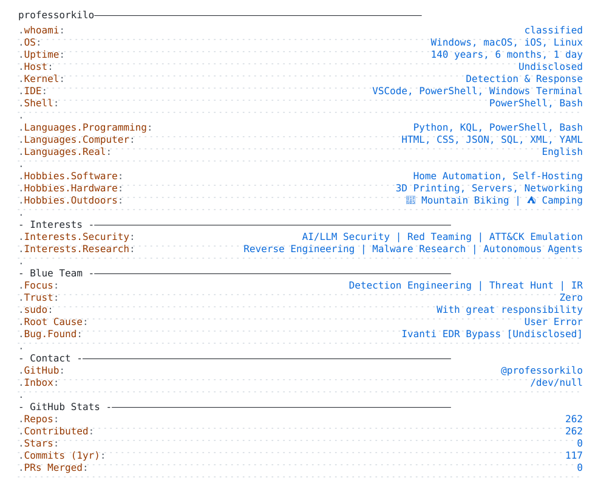

## `$ whoami`

  

<picture>
  <source media="(prefers-color-scheme: dark)"
          srcset="https://raw.githubusercontent.com/professorkilo/professorkilo/main/dark_mode.svg">
  <source media="(prefers-color-scheme: light)"
          srcset="https://raw.githubusercontent.com/professorkilo/professorkilo/main/light_mode.svg">
  
</picture>
